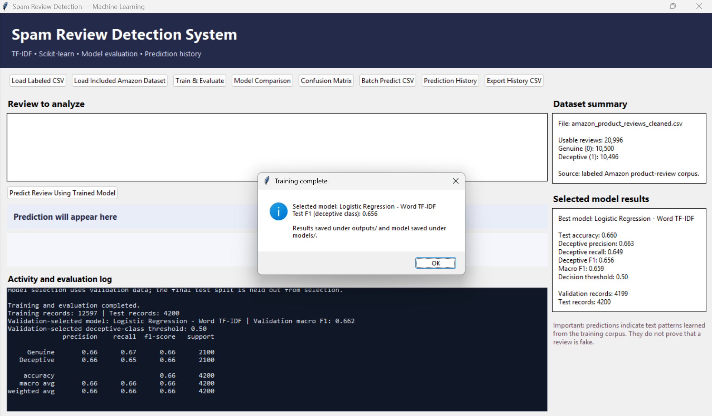
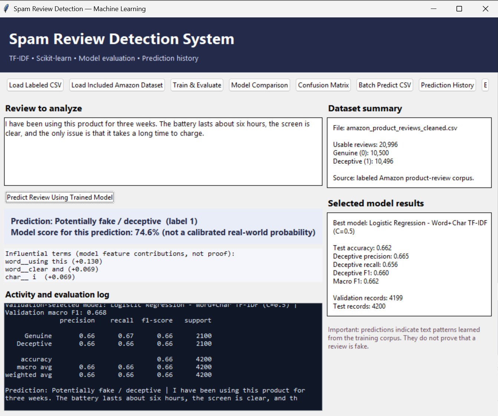
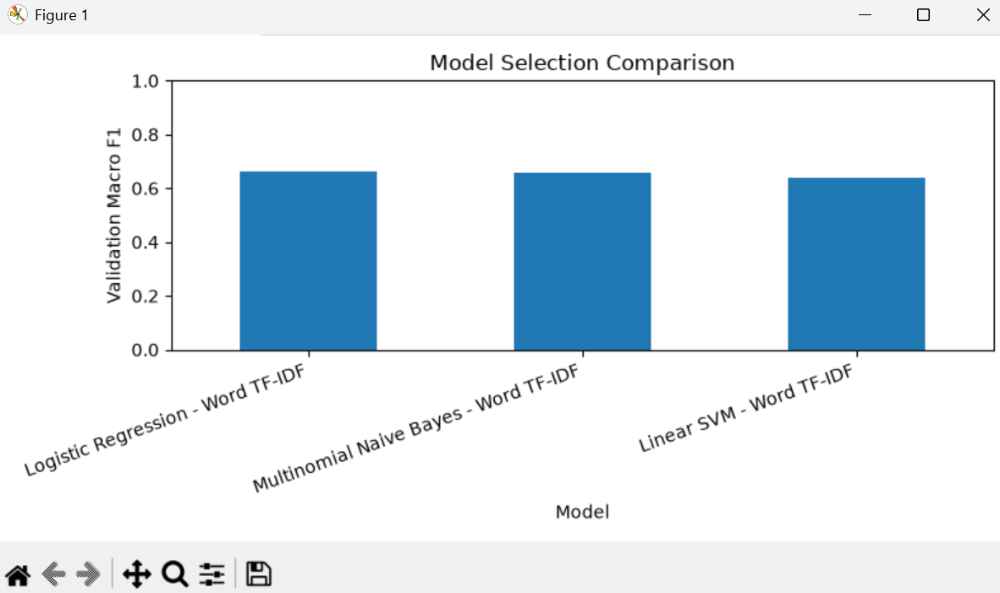
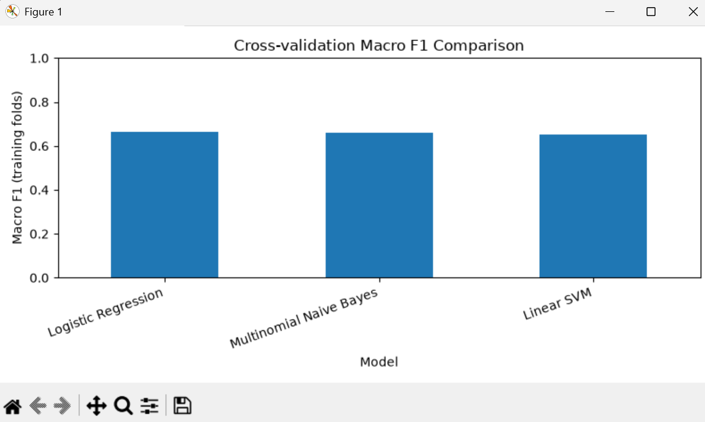
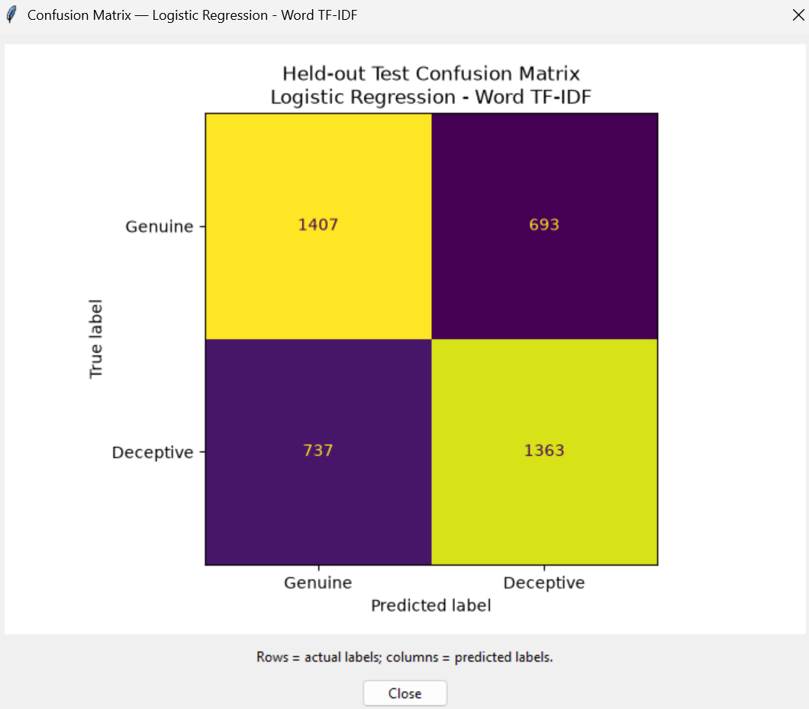

# Spam Review Detection System — Advanced Upgrade

A Tkinter desktop application that classifies **labeled review text** using TF-IDF and Scikit-learn. This upgraded version replaces the old Spambase numerical-feature workflow and removes the keyword-only review prediction demo.

> **Important limitation:** a model prediction is not proof that a review is fake. This package includes a labeled Amazon-style product-review dataset. Performance may not transfer to other products, languages, websites, or newer review patterns.

## Features

- Load and validate a labeled review CSV
- Train and compare word-TF-IDF Logistic Regression, Multinomial Naive Bayes, and Linear SVM
- Select a model using a separate validation split
- Evaluate the selected model on a held-out test split
- View accuracy, deceptive-class precision/recall/F1, macro F1 and confusion matrix
- Predict a single review using the trained text model
- Show influential terms for linear models (feature contributions, not explanations of intent)
- Store prediction history in SQLite
- Export prediction history to CSV
- Compare model validation macro-F1 scores in a chart
- Run a dataset audit for exact duplicates, label balance, metadata association, and category distribution
- Run diagnostic random/product-held-out/category-held-out evaluation

## Dataset format

The CSV should contain one review text column and one label column. The app recognizes common text column names such as `review_text`, `review`, `text`, or `content`, and label names such as `label`, `class`, or `target`.

Canonical format:

```csv
review_text,label
"The staff were helpful and the room was clean.",0
"An example of a labeled deceptive review.",1
```

- `0` = genuine/truthful
- `1` = deceptive/fake

Labels can also be words such as `truthful` / `deceptive`, `genuine` / `fake`, or `real` / `spam`.

A blank template is available at `data/reviews_template.csv`. **Do not train on made-up examples**; use a real labeled corpus.

## Included dataset

The project includes `data/amazon_product_reviews_cleaned.csv` with approximately 21,000 labeled product reviews and metadata columns. The text classifier uses only `review_text` and `label`; metadata such as rating and verified-purchase status is not used as model input. Review the dataset audit before interpreting performance. The labels come from the source dataset and are not independently verified by this application.

## Install and run (Windows)

1. Install Python 3.10 or newer.
2. Extract the project folder.
3. Open Command Prompt in the project folder.
4. Install dependencies:

   ```bash
   python -m pip install -r requirements.txt
   ```

5. Launch the GUI:

   ```bash
   python SpamFilter.py
   ```

   Or double-click `run.bat`.

## Workflow

1. Click **Load Labeled CSV** and choose your dataset.
2. Click **Train & Evaluate**. The app removes blank reviews, normalizes labels, removes case/whitespace-normalized duplicate text (and removes normalized texts with conflicting labels), uses a training split to fit models, chooses the best model using validation macro-F1, then evaluates the selected model once on a separate test split. The deployed model is then refit on all labeled rows; held-out test metrics are preserved from before that refit.
3. Use **Model Comparison** to compare validation macro-F1 across baseline models.
4. Enter review text and click **Predict Review Using Trained Model**.
5. Use **Prediction History** and **Export History CSV** to inspect or export past predictions.

## Dataset and generalization audit

Run these optional diagnostic scripts from the project folder:

```bash
python -m src.audit_dataset
python -m src.generalization_eval
```

The first writes `outputs/dataset_audit.txt`. The second writes `outputs/generalization_results.csv` and `outputs/generalization_details.json`. These are diagnostic evaluations; they do not prove that source labels are correct. Product/category split results can vary by random seed and should be repeated for formal research.

## Output files

- `models/review_model.joblib`: fitted TF-IDF + classifier pipeline; retrain it on your machine before relying on predictions
- `models/model_metadata.json`: selected model and evaluation setup from the included prior run
- `outputs/evaluation_results.csv`: validation comparison from the included prior run
- `data/review_history.db`: local SQLite prediction history, created at runtime

Training replaces the saved model and evaluation outputs. Treat any bundled metrics as examples from a prior run, not a guarantee of your results.

## Evaluation caveats

- The selected model is chosen using validation macro-F1; the held-out test split is used for final evaluation and is not used to choose the model.
- The corpus is small. Results can vary by split and may not transfer to modern e-commerce reviews.
- If multiple reviews belong to the same hotel or product, a random split can overestimate generalization. For a research-grade evaluation, use group-aware splitting by hotel/product when metadata permits.
- Text-only classification can learn dataset-specific writing patterns. Treat outputs as screening signals, not definitive accusations.
- The displayed influential terms are linear-model feature contributions. They are not causal explanations and do not establish intent.

## Screenshots

These screenshots are captured from the current desktop application and its evaluation windows. They are included for a quick visual preview; run the app locally to interact with the controls.

### Application interface





### Model evaluation







## Project structure

```text
Spam-Review-Detection-System-main/
├── SpamFilter.py
├── requirements.txt
├── run.bat
├── README.md
├── data/
│   ├── reviews_template.csv
│   └── review_history.db       # created at runtime
├── models/                     # created after training
├── outputs/                    # created after training
└── src/
    ├── data_loader.py
    ├── train_models.py
    ├── predict_review.py
    ├── database.py
    ├── audit_dataset.py
    └── generalization_eval.py
```
