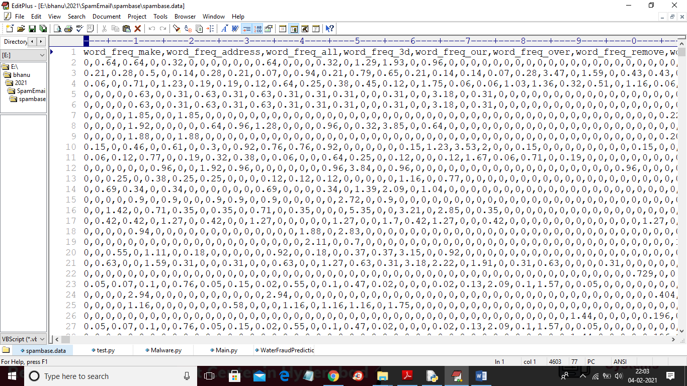
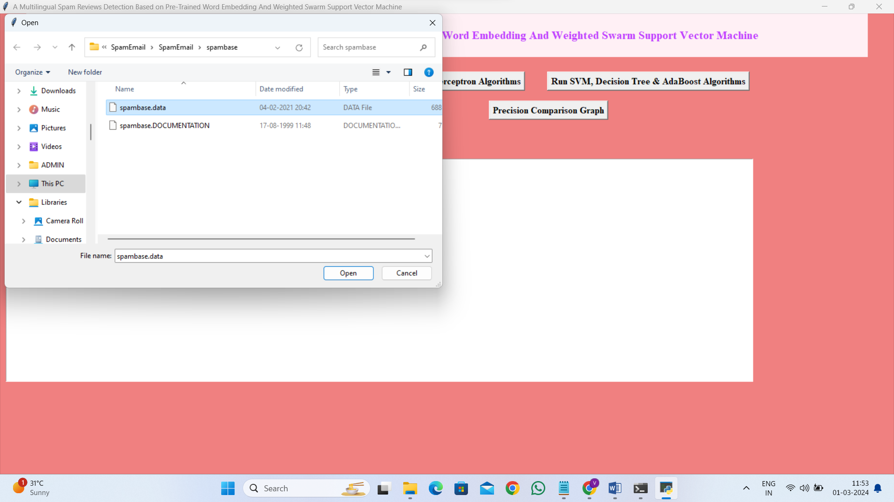
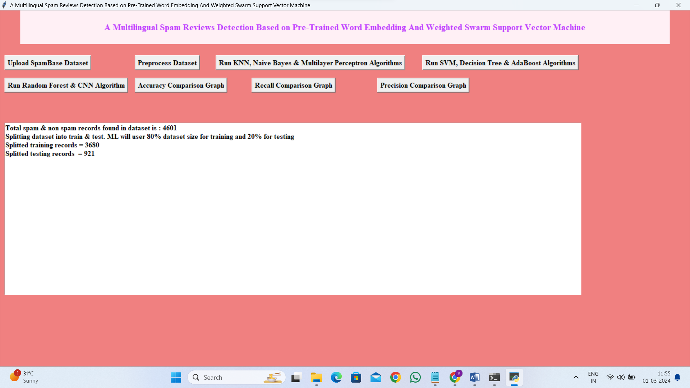
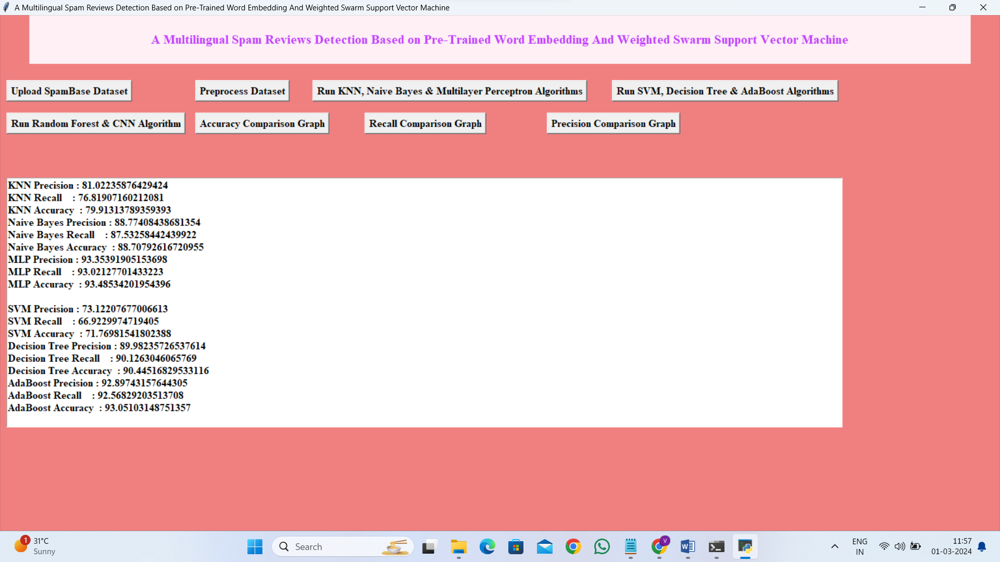
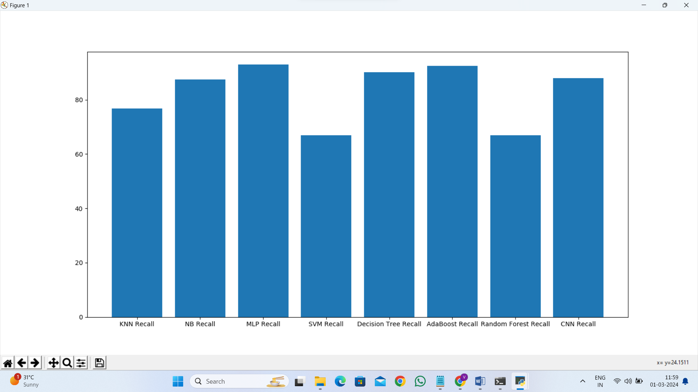
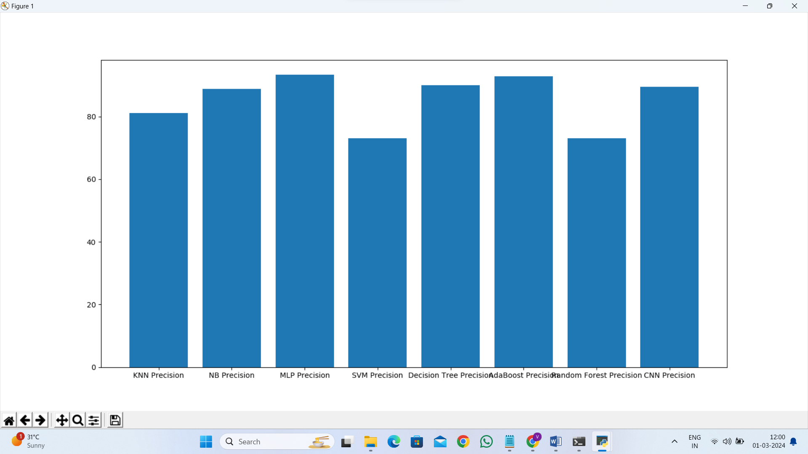
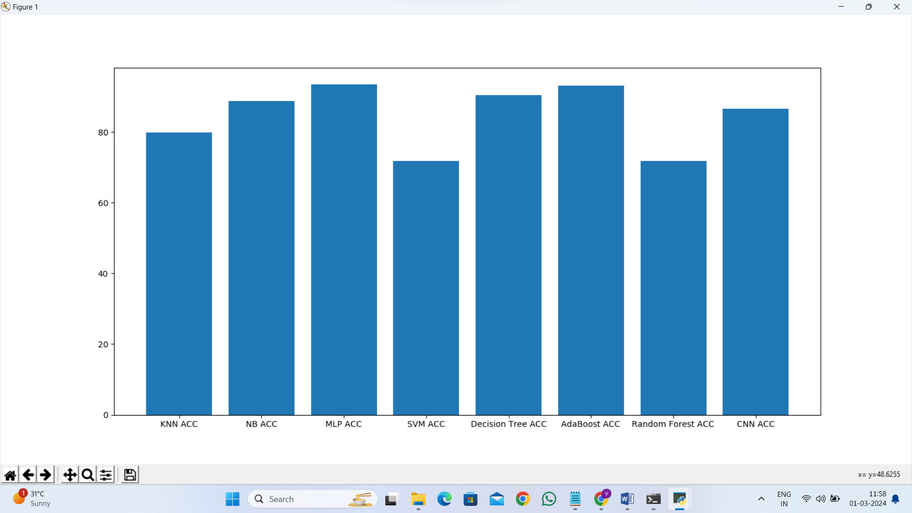

# Spam Review Detection Using Machine Learning

## Project Overview

This project demonstrates spam detection using the SPAMBASE dataset and compares multiple machine-learning classification algorithms.

The application provides a simple Tkinter GUI to:

1. Upload the SPAMBASE dataset.
2. Preprocess the data and create an 80/20 train-test split.
3. Train and evaluate multiple machine-learning algorithms.
4. Compare Accuracy, Precision and Recall.
5. Run a small rule-based review-checking demonstration.

## Dataset

The project uses the SPAMBASE dataset containing 4,601 records and 57 input features plus a `Label` column.

- `0` = normal/non-spam
- `1` = spam

Dataset file:

`data/spambase.data`

## Algorithms

The current GitHub version evaluates:

- K-Nearest Neighbors (KNN)
- Bernoulli Naive Bayes
- Multilayer Perceptron (MLP)
- Support Vector Machine (SVM)
- Decision Tree
- AdaBoost
- Random Forest

## Evaluation Metrics

The models are evaluated on the held-out test set using:

- Accuracy
- Precision
- Recall

The application displays comparison graphs for these metrics.

## Data Split

The dataset is divided using:

- 80% training data
- 20% testing data

A fixed random state is used so that the split is reproducible.

## Important Note About Review Checking

The `Check Review` button is a **rule-based demonstration**. It checks whether the entered text contains a small list of spam-related keywords such as `buy`, `free`, `offer`, `win`, `click`, or `money`.

It is separate from the SPAMBASE machine-learning evaluation because SPAMBASE contains engineered numerical features rather than original review text.

## Project Structure

```text
Spam-Review-Detection/
├── SpamFilter.py
├── run.bat
├── requirements.txt
├── README.md
├── data/
│   └── spambase.data
└── screenshots/
    ├── dataset.png
    ├── upload_dataset.png
    ├── dataset_loaded.png
    ├── preprocessing.png
    ├── algorithm_results.png
    ├── accuracy_comparison.png
    ├── recall_comparison.png
    └── precision_comparison.png
```

## How to Run

### 1. Install Python

Use Python 3.x.

### 2. Install dependencies

```bash
pip install -r requirements.txt
```

### 3. Run the project

Either double-click:

`run.bat`

or run:

```bash
python SpamFilter.py
```

### 4. Use the application

- Click **Upload SPAMBASE Dataset**
- Select `data/spambase.data`
- Click **Preprocess Dataset**
- Run the algorithm groups
- View Accuracy, Recall and Precision comparisons
- Optionally use the rule-based review demonstration

## Screenshots

### Dataset


### Upload Dataset


### Preprocessing


### Algorithm Results


### Accuracy Comparison


### Recall Comparison


### Precision Comparison


## Interview Explanation

A concise explanation:

> This project is a machine-learning based spam detection system. We use the SPAMBASE dataset, preprocess it and split it into training and testing data in an 80/20 ratio. We train multiple classification algorithms such as KNN, Naive Bayes, MLP, SVM, Decision Tree, AdaBoost and Random Forest. We then compare their performance using accuracy, precision and recall and visualize the results using graphs.

## Limitations

- The SPAMBASE dataset contains numerical engineered features rather than original review text.
- The review-entry feature is a simple keyword-based demonstration and is not the trained ML model.
- Model performance depends on the selected dataset and train-test split.
